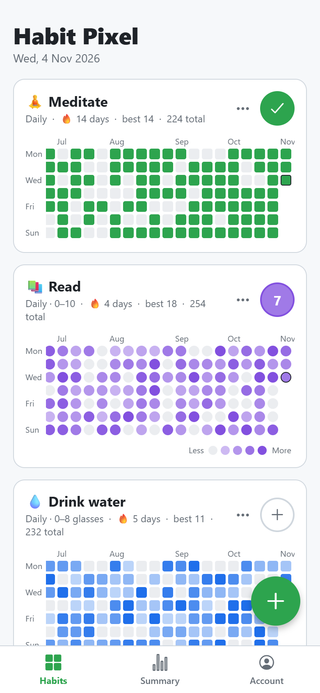
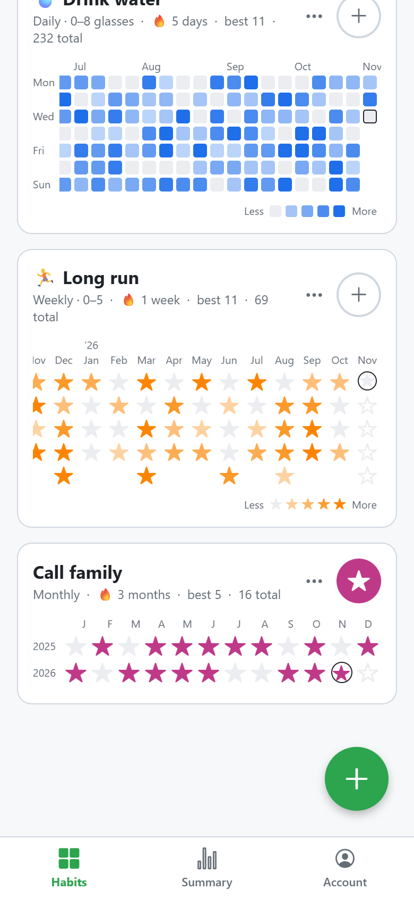
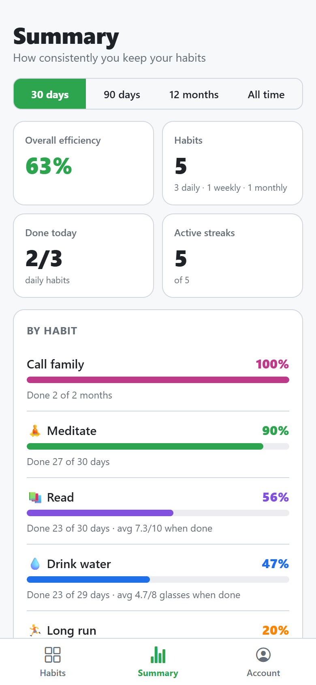
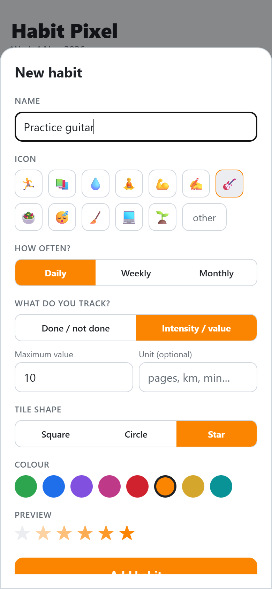
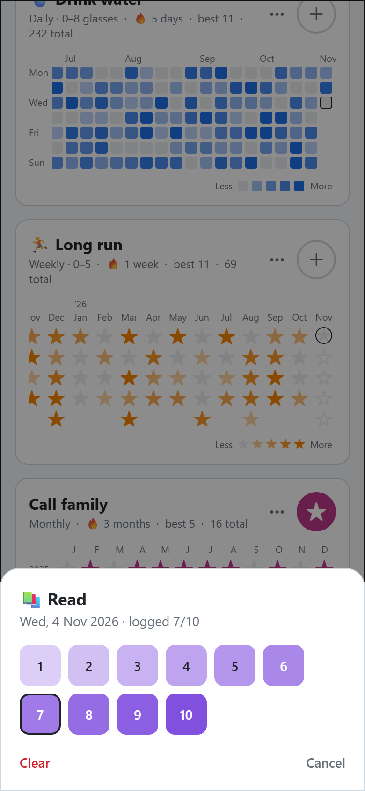
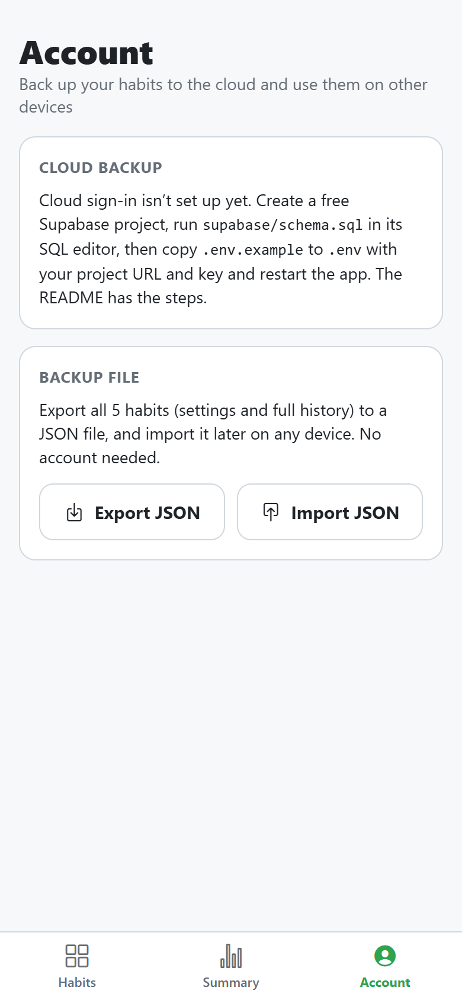
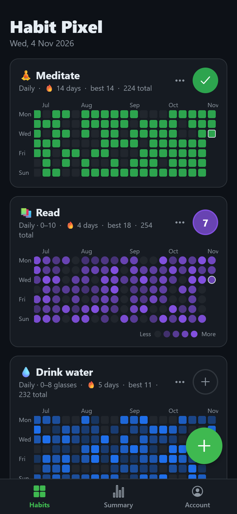
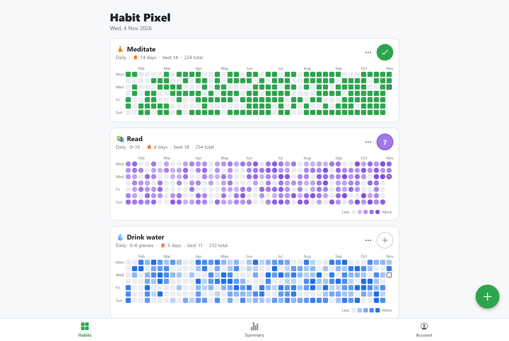

# Habit Pixel

**Track your habits as GitHub-style contribution tiles.** Log daily, weekly or monthly habits, as simple yes/no checks or with an intensity (e.g. "read 7/10"), and watch your history fill in as a colourful calendar grid. One codebase runs on **Android** and in the **browser**, built with React Native + Expo.

<p align="center">
  
  
  
</p>

## Features

- **Any frequency.** Daily habits show a 53-week grid like GitHub's contribution graph (one column per week, Mon–Sun). Weekly habits show one column per month with a tile per week. Monthly habits show a row per year.
- **Optional targets.** Set how many times per period counts as reaching the goal, e.g. *at least 3 times a week* or *8 times a month*, and the tile fills up as you get closer. Leave it at 0 for no target: any entry marks the period as done.
- **Yes/no or intensity.** Every time you do a habit you log an entry. Intensity habits record a value with each entry, up to a maximum you choose (e.g. 10, or 8 km), and the tile fades with how much you did: 3/10 is faint, 10/10 is full colour.
- **Your style.** Square, circle or star tiles, 8 colours, an emoji icon and an optional unit.
- **Entry list per period.** The round button on each card (today, this week or this month) and every tile in the grid open that period's numbered entries, where you add or remove single entries, or set it back to 0.
- **Streaks.** Current and best streak of periods that reached the target, plus total entries, for every habit.
- **Summary page.** Targets hit and efficiency per habit and overall, over 30 days, 90 days, 12 months or all time, plus this period's progress, habits at target today and active streaks.
- **Backups.** Export everything as an Excel file (opens in Excel and Google Sheets) or JSON, and import it on any device, merging with or replacing what's there. Import straight from a Google Sheets link. Optional cloud backup with an email login (Supabase).
- **Light and dark mode**, following your system setting. Works offline; data stays on the device unless you back it up.

## Screenshots

| Add a habit | Log an intensity | Account & backups | Dark mode |
| :---: | :---: | :---: | :---: |
|  |  |  |  |

On a wide screen (web):



## How efficiency is calculated

Habits are judged per **period**: a day, week or month, depending on the habit.

- **Targets hit** = periods with at least *target* entries ÷ periods counted. Habits without a target (0) are left out of it; for them a period is done once anything is logged.
- **Efficiency** also gives credit for partial progress. Each period scores `min(entries ÷ target, 1)`, multiplied for intensity habits by the average `value ÷ max` of its entries. Periods with nothing logged score **0**; efficiency is the average score.
- Counting starts when the habit was created, or at its earliest logged entry if you backfilled.
- The current day, week or month only counts once its target is reached, so an unfinished week doesn't lower your score.
- **Overall** numbers are averages across habits, so every habit counts equally whatever its frequency.

Example: a *3 times a week* run. Weeks with 3 or more runs hit the target and score 100%; a week with 2 runs misses it but scores 67% towards efficiency. With target 1, reading 5/10 every day for 30 days gives 50% efficiency and 100% targets hit.

## Getting started

Requires [Node.js](https://nodejs.org) 20 or newer.

```bash
git clone https://github.com/AnshKapoor/habit-pixel.git
cd habit-pixel
npm install
npm run web        # opens http://localhost:8081
```

### On an Android phone

**Quickest (no build):** install **Expo Go** from the Play Store, run `npm start`, and scan the QR code. Your phone and computer need to be on the same Wi-Fi.

**Installable APK:** build in the cloud with [EAS](https://docs.expo.dev/build/introduction/). This needs a free Expo account.

```bash
npx eas-cli@latest login
npx eas-cli@latest build -p android --profile preview
```

When the build finishes (about 10–20 minutes), open the link on your phone to download and install the APK.

### On Windows (desktop app)

The desktop app is the web build in an [Electron](https://www.electronjs.org/) window, with its own icon, Start-menu entry and offline storage.

```bash
npm run desktop         # build the web app and open it in a desktop window
npm run desktop:build   # make the Windows installer and a portable .exe
```

`desktop:build` writes to `desktop/release/`:

- `Habit-Pixel-Setup-<version>.exe`: installer (choose the folder, adds Start-menu and desktop shortcuts, uninstalls from Windows Settings).
- `Habit-Pixel-<version>-portable.exe`: single file that runs without installing.

The files are not code-signed, so Windows SmartScreen shows a warning the first time; choose **More info → Run anyway**. Habits are stored on that PC (`%APPDATA%\Habit Pixel`); use JSON export/import or cloud backup to move them between the phone and the desktop. The version comes from `app.json`.

## Backups

### Excel, Google Sheets or JSON file (no account needed)

In the **Account** tab, under **Backup file**:

- **Export → Excel (.xlsx)** saves every habit with its settings and full history as a spreadsheet you can open in Excel, LibreOffice or Google Sheets (upload it to Drive). It has three tabs:
  - **Habits**: one row per habit (ID, Name, Icon, Colour, How often, Kind, Max value, Unit, Shape, Target, Created).
  - **Entries**: one row per logged entry (Habit ID, Habit, Period start, Entry #, Value).
  - **How to edit**: notes for editing by hand.
- **Export → JSON** saves the same data as an exact backup file.
- On the web and desktop both download `habit-pixel-YYYY-MM-DD.xlsx` / `.json`; on Android they open the share sheet, so you can save the file to Drive or Files, or email it.
- **Import → Excel or JSON file** reads either format (also `.xls` and `.ods`).
- **Import → Google Sheets link** reads a Google Sheet with the same Habits and Entries tabs. Share it as *Anyone with the link: Viewer* (or *File → Share → Publish to web*) and paste the link. The app only reads the sheet.

You can edit the spreadsheet before importing it again: add rows to **Entries** to backfill history (any date inside the week or month works, preferably written as `YYYY-MM-DD`; `DD.MM.YYYY` and real date cells work too), delete rows to remove entries, or add a habit row with an empty **ID** to create a new habit. Rows that can't be read are skipped and counted.

Every import shows what it found before changing anything, then lets you choose:
  - **Merge with mine:** keeps your habits, adds new ones, and combines the history of habits found in both (matched by id; the file's settings win).
  - **Replace all mine:** swaps your habits for the file's.

Imported files are checked: unreadable habits are skipped, missing settings get defaults, and out-of-range values are capped. A bare JSON array of habits works too, so you can write habits by hand:

```json
[
  { "name": "Read", "emoji": "📚", "frequency": "daily", "kind": "value", "maxValue": 10,
    "entries": { "2026-11-01": [6], "2026-11-02": [9, 4] } },
  { "name": "Run", "frequency": "weekly", "kind": "boolean", "target": 3,
    "entries": { "2026-10-27": [1, 1, 1] } }
]
```

Entry keys are the start of each period: the date for daily habits, the **Monday** for weekly ones, and the **1st** for monthly ones. Each holds a list with one value per entry (`1` for yes/no habits). Files from older versions, with a single number per period and no `target`, still import.

### Cloud backup (optional, Supabase)

1. Create a free project at [supabase.com](https://supabase.com).
2. Open **SQL Editor**, paste [`supabase/schema.sql`](supabase/schema.sql) and run it. This creates a `habit_backups` table with row-level security, so each user can only access their own backup.
3. In the app, open **Account → Connect cloud** and paste the project URL and the **anon / publishable** key (from **Connect** or **Project Settings → API Keys**). The app checks the connection and stores it on the device. Never use the `service_role` / secret key; the app rejects it.

The **How to set up** link next to the button opens the same steps as an in-app FAQ, including a **Copy SQL** button.

You can then create an account in the **Account** tab and use **Save to cloud** / **Restore from cloud**. Each account keeps one backup, replaced on every save. Supabase asks new users to confirm their email by default; you can turn this off under **Authentication → Sign In / Providers → Email** while testing.

Optional: to ship a build that is already connected, put `EXPO_PUBLIC_SUPABASE_URL` and `EXPO_PUBLIC_SUPABASE_KEY` in `.env` (see `.env.example`) or in [EAS environment variables](https://docs.expo.dev/eas/environment-variables/). A project entered in the app takes priority.

## Roadmap

These are ideas for future versions, not commitments. They're grouped into rough sprints, quick wins first, and the order may change.

### Sprint 1: Daily-use basics (v1.3)

- [ ] **Smart reminders.** A notification per habit at a chosen time (`expo-notifications`). It is skipped when the habit is already logged for the period, and a nudge is sent when a target is at risk (e.g. *"1 more run to hit 3 this week"*).
- [ ] **Haptic feedback.** A light tap when you log an entry and a stronger one when you hit a target or extend a streak (`expo-haptics`).
- [ ] **Streak freezes and rest days.** Planned rest days, or a limited number of freezes, keep a streak alive, so one missed day doesn't wipe out months of progress.

### Sprint 2: Navigation and deep links (v1.4)

- [ ] **Move to Expo Router.** Replace the hand-made tab switching in `App.tsx` with file-based routes in `src/app/`.
- [ ] **Deep links.** URLs such as `habitpixel://log/<habit>` open a habit or log it directly. Reminders, widgets and shortcuts use them.
- [ ] **Quick actions.** Long-press the app icon for shortcuts like *Log Meditation*.

### Sprint 3: Home screen (v1.5)

- [ ] **Home-screen widget.** A small pixel grid for one or more habits, with one-tap logging from the home screen.

### Sprint 4: Insights and AI (v1.6)

- [ ] **Weekly insights.** A short summary worked out on the device from your history, e.g. *"You hit your workout target 3 weeks in a row; Sundays are your weakest day."* An LLM could optionally phrase it, but only if you turn that on.
- [ ] **Logging in plain language or by voice.** *"Ran 5 km and read 20 pages"* logs both habits.
- [ ] **Habit coaching.** When a target keeps being missed, the app suggests a smaller one (e.g. *2×/week instead of 4*), because shrinking a habit keeps people going better than streak pressure.

### Sprint 5: Sharing and motivation (v1.7)

- [ ] **Year-in-pixels image.** Export a habit's heatmap as a styled image and share it (`expo-sharing`).
- [ ] **Habit stacking.** Link habits into a routine (*after coffee → journal*) and show them together, in the order you do them.

### Sprint 6: Data and sync (v2.0)

- [ ] **A real local database.** Move from a single AsyncStorage entry to one portable file: either SQLite with JSON columns (`expo-sqlite`, optionally with TinyBase on top) or a plain JSON file via `expo-file-system`. Saves are atomic (write a temp file, then rename), with IndexedDB on the web.
- [ ] **Two-way cloud sync.** Turn the one-way Supabase backup into live sync, so the phone and the Windows app share the same habits.
- [ ] **Over-the-air updates.** Ship fixes with `eas update` without reinstalling the APK.

## Project structure

| Path | Purpose |
| --- | --- |
| `App.tsx` | Tab bar: Habits / Summary / Account |
| `src/screens/` | The three screens |
| `src/components/Heatmap.tsx` | Daily, weekly and monthly grids |
| `src/components/HabitCard.tsx` | A habit card with stats and its grid |
| `src/components/HabitEditor.tsx` | Add/edit habit form |
| `src/components/EntriesSheet.tsx` | Entries of one period: add, remove, set to 0 |
| `src/store.tsx` | Habit state, saved with AsyncStorage (localStorage on web) |
| `src/dates.ts` | Period keys: day, Monday of the week, 1st of the month |
| `src/stats.ts` | Intensity, streaks, totals |
| `src/summary.ts` | Efficiency calculation |
| `src/backup.ts` | Export/import (JSON and Excel), validation, merge |
| `src/spreadsheet.ts` | Excel workbook layout, spreadsheet import, Google Sheets links |
| `src/cloud.ts` | Supabase client, login session, cloud save/restore |
| `supabase/schema.sql` | Database table and access rules for cloud backups |
| `desktop/` | Electron shell (`app/main.js`), build script and installer config |

**Tech:** Expo SDK 58 · React Native 0.88 · TypeScript · react-native-web · Electron · Supabase · SheetJS · AsyncStorage

## License

[MIT](LICENSE)
